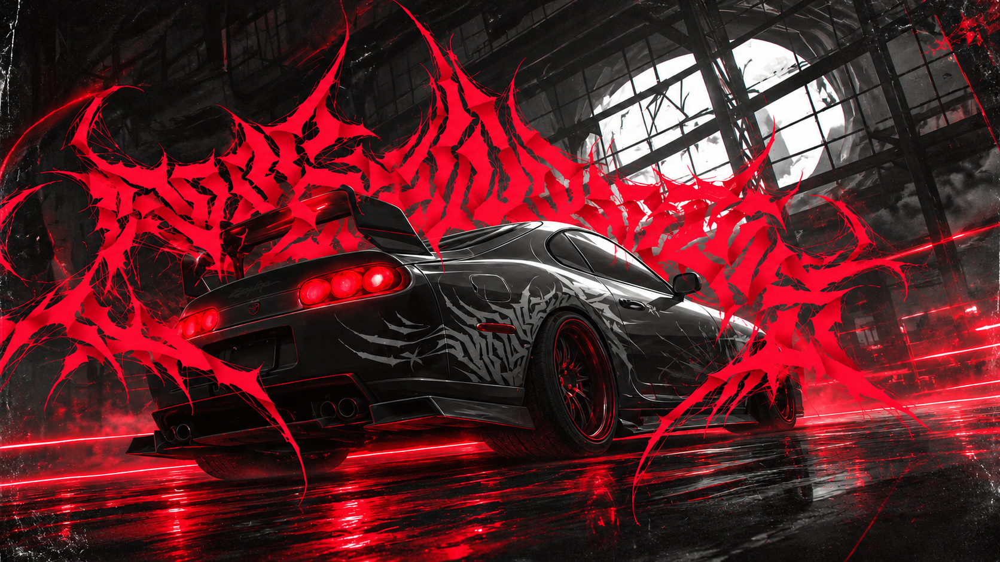

<p align="center">
  
</p>

<div align="center">

  

  <p><samp>SOFTWARE  /  INTERFACES  /  JOGOS</samp></p>

  <h1>Ｏｌá，　Ｍｅｕ　ｎｏｍｅ　é　Ａｌｅｆ．<span>.</span></h1>

  <p>
    𝐆𝐨𝐬𝐭𝐨 𝐝𝐞 𝐭𝐫𝐚𝐧𝐬𝐟𝐨𝐫𝐦𝐚𝐫 𝐢𝐝𝐞𝐢𝐚𝐬 𝐞𝐦 𝐩𝐫𝐨𝐣𝐞𝐭𝐨𝐬 𝐞 𝐜𝐫𝐢𝐚𝐫 𝐞𝐱𝐩𝐞𝐫𝐢𝐞̂𝐧𝐜𝐢𝐚𝐬 𝐝𝐢𝐠𝐢𝐭𝐚𝐢𝐬<𝐛𝐫> 𝐪𝐮𝐞 𝐜𝐨𝐦𝐛𝐢𝐧𝐞𝐦
    <𝐛>𝐟𝐮𝐧𝐜𝐢𝐨𝐧𝐚𝐥𝐢𝐝𝐚𝐝𝐞</𝐛>, <𝐛>𝐢𝐝𝐞𝐧𝐭𝐢𝐝𝐚𝐝𝐞 𝐯𝐢𝐬𝐮𝐚𝐥</𝐛> 𝐞 <𝐛>𝐚𝐭𝐞𝐧𝐜̧𝐚̃𝐨 𝐚𝐨𝐬 𝐝𝐞𝐭𝐚𝐥𝐡𝐞𝐬</𝐛>.
  </p>

</div>

<br>

## `01 / SOBRE`

```text
Sou estudante de Desenvolvimento de Software Multiplataforma na FATEC Jacareí,
com interesse em front-end, tecnologia e experiências digitais.
```

<p align="center">
  
</p>

## `02 / TECNOLOGIAS`

`React` &nbsp; `JavaScript` &nbsp; `HTML` &nbsp; `CSS` &nbsp; `Git`

**Áreas de interesse:** desenvolvimento web, interfaces, design de interação e projetos experimentais.

<p align="center">
  
</p>

## `03 / PROJETOS EM DESTAQUE`

<table>
  <tr>
    <td width="50%" valign="top">
      <h3>LIN0</h3>
      <p>protótipo de hero shooter em primeira pessoa, construído com tecnologias web.</p>
      <a href="https://github.com/VtecturboBr/LIN0---Web-Hero-Shooter-Game">Explorar projeto ↗</a>
    </td>
    <td width="50%" valign="top">
      <h3>SCRUM DUNGEON</h3>
      <p>Aprender Scrum também pode ser uma aventura. Um RPG educativo com cinco níveis, desafios e conquistas, desenvolvido pela equipe Octopus Code.</p>
      <a href="https://github.com/octopusCode26/scrum-dungeon">Explorar projeto ↗</a>
    </td>
  </tr>
</table>

<br>

<div align="center">
  
  <sub>Obrigado por visitar meu perfil.</sub>
</div>

