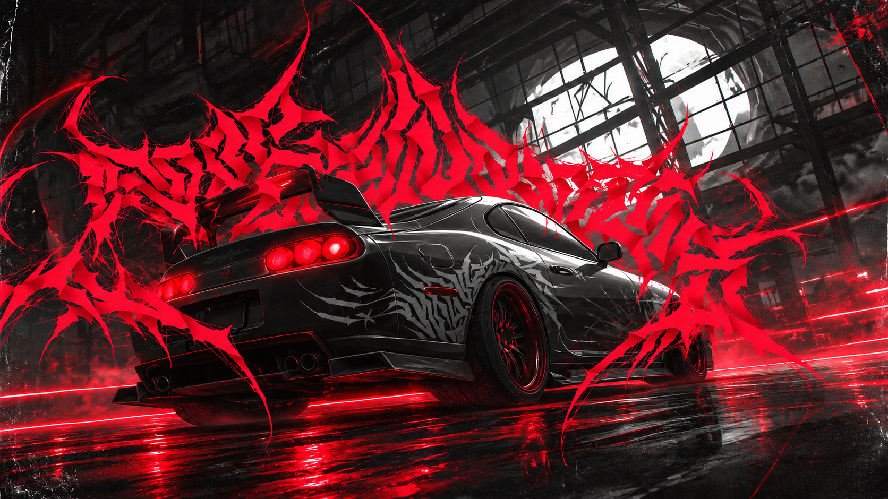

  
  
  <h1><samp>𝙎𝙊𝙁𝙏𝙒𝘼𝙍𝙀 / 𝙄𝙉𝙏𝙀𝙍𝙁𝘼𝘾𝙀𝙎 / 𝙅𝙊𝙂𝙊𝙎</samp></h1>
  
  
    
  

 

<h2 align="center">
  <code>ＳＯＢＲＥ</code>
</h2>

  <h2>
         𝐒𝐨𝐮 𝐞𝐬𝐭𝐮𝐝𝐚𝐧𝐭𝐞 𝐝𝐞 𝐃𝐞𝐬𝐞𝐧𝐯𝐨𝐥𝐯𝐢𝐦𝐞𝐧𝐭𝐨 𝐝𝐞 𝐒𝐨𝐟𝐭𝐰𝐚𝐫𝐞 𝐌𝐮𝐥𝐭𝐢𝐩𝐥𝐚𝐭𝐚𝐟𝐨𝐫𝐦𝐚 𝐧𝐚 𝐅𝐀𝐓𝐄𝐂 𝐉𝐚𝐜𝐚𝐫𝐞𝐢́,
                  𝐜𝐨𝐦 𝐢𝐧𝐭𝐞𝐫𝐞𝐬𝐬𝐞 𝐞𝐦 𝐟𝐫𝐨𝐧𝐭-𝐞𝐧𝐝, 𝐉𝐨𝐠𝐨𝐬 𝐞 𝐞𝐱𝐩𝐞𝐫𝐢𝐞̂𝐧𝐜𝐢𝐚𝐬 𝐝𝐢𝐠𝐢𝐭𝐚𝐢𝐬.
    𝐆𝐨𝐬𝐭𝐨 𝐝𝐞 𝐭𝐫𝐚𝐧𝐬𝐟𝐨𝐫𝐦𝐚𝐫 𝐢𝐝𝐞𝐢𝐚𝐬𝐞𝐦 𝐩𝐫𝐨𝐣𝐞𝐭𝐨𝐬 𝐞 𝐜𝐫𝐢𝐚𝐫 𝐞𝐱𝐩𝐞𝐫𝐢𝐞̂𝐧𝐜𝐢𝐚𝐬 𝐝𝐢𝐠𝐢𝐭𝐚𝐢𝐬 𝐪𝐮𝐞 𝐜𝐨𝐦𝐛𝐢𝐧𝐞𝐦 𝐟𝐮𝐧𝐜𝐢𝐨𝐧𝐚𝐥𝐢𝐝𝐚𝐝𝐞, 
             𝐢𝐝𝐞𝐧𝐭𝐢𝐝𝐚𝐝𝐞 𝐯𝐢𝐬𝐮𝐚𝐥 𝐞 𝐚𝐭𝐞𝐧𝐜̧𝐚̃𝐨 𝐚𝐨𝐬 𝐝𝐞𝐭𝐚𝐥𝐡𝐞𝐬. 𝐆𝐨𝐬𝐭𝐨 𝐝𝐞 𝐭𝐫𝐚𝐧𝐬𝐟𝐨𝐫𝐦𝐚𝐫 𝐢𝐝𝐞𝐢𝐚𝐬
             𝐞𝐦 𝐩𝐫𝐨𝐣𝐞𝐭𝐨𝐬 𝐞 𝐜𝐫𝐢𝐚𝐫 𝐞𝐱𝐩𝐞𝐫𝐢𝐞̂𝐧𝐜𝐢𝐚𝐬 𝐝𝐢𝐠𝐢𝐭𝐚𝐢𝐬 𝐪𝐮𝐞 𝐜𝐨𝐦𝐛𝐢𝐧𝐞𝐦 𝐟𝐮𝐧𝐜𝐢𝐨𝐧𝐚𝐥𝐢𝐝𝐚𝐝𝐞, 
                         𝐢𝐝𝐞𝐧𝐭𝐢𝐝𝐚𝐝𝐞 𝐯𝐢𝐬𝐮𝐚𝐥 𝐞 𝐚𝐭𝐞𝐧𝐜̧𝐚̃𝐨 𝐚𝐨𝐬 𝐝𝐞𝐭𝐚𝐥𝐡𝐞𝐬.
  <h2>
    
  

 

<h2 align="center">
  <code>ＴＥＣＮＯＬＯＧＩＡＳ</code>
</h2>

  

    
    &nbsp;&nbsp;
    
    &nbsp;&nbsp;
    
    &nbsp;&nbsp;
    
    &nbsp;&nbsp;
    
  

  

 

<h2 align="center">
  <code>ＰＲＯＪＥＴＯＳ　ＥＭ　ＤＥＳＴＡＱＵＥ</code>
</h2>

<table width="100%">
<tr>
<td width="50%" align="center" valign="top">
<h3>ＬＩＮ０</h3>

protótipo de hero shooter em primeira pessoa, construído com tecnologias web.

<a href="https://github.com/VtecturboBr/LIN0---Web-Hero-Shooter-Game">Explorar projeto ↗</a>

</td>
<td width="50%" align="center" valign="top">
<h3>SCRUM DUNGEON</h3>

Aprender Scrum também pode ser uma aventura. Um RPG educativo com cinco níveis, desafios e conquistas, desenvolvido pela equipe Octopus Code.

<a href="https://github.com/octopusCode26/scrum-dungeon">Explorar projeto ↗</a>

</td>
</tr>
</table>

 

        
  
  Obrigado por visitar meu perfil.

